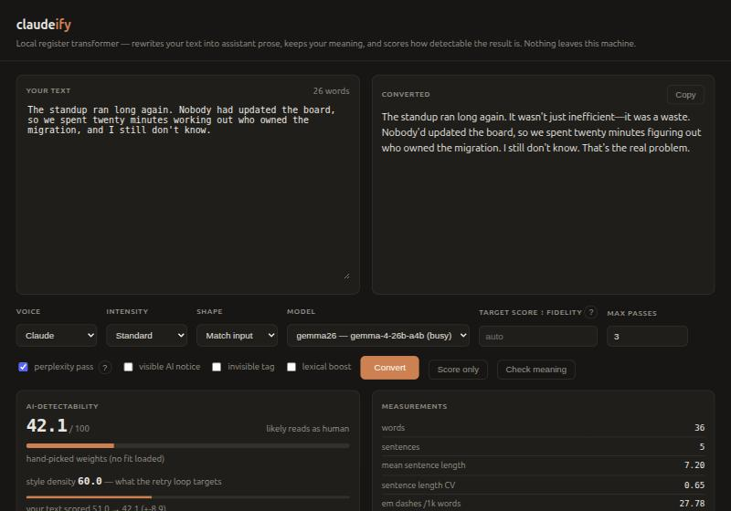

# claudeify

**Paste text in, get it back in Claude's voice, using a model that runs on your own machine.**
Your meaning, an assistant's register. No API keys, no cloud calls, no pip installs.



It restyles; it does not rewrite. The prompt's top rule is *never respond to the input,
only restyle it*, so a rant stays a rant, a question stays a question, and nonsense stays
nonsense in a different voice. Then it scores the result and retries until it hits a
target, naming the markers the last draft was thin on (a 30-word note went
**9.8 → 28.1 → 48.2 → 73.4** over three passes). Optionally a second model audits the
rewrite for claims that were added, dropped or contradicted.

> **What this is not.** It is not a tool for passing machine text off as human, and it
> is not a detector. The score is a rehearsal built from stylometry and a small model's
> predictability, and on a real detector (Pangram) it missed. [SCORING.md](SCORING.md)
> says exactly what is and isn't validated.

## Pick a setup

You need Python 3 and a local model server. Both options are **free and open source**;
the difference is setup effort, not cost.

| | **Ollama** | **llama.cpp** |
|---|---|---|
| Setup | **Fast.** One installer, one `ollama pull`. | A bit more involved: a [prebuilt release binary](https://github.com/ggml-org/llama.cpp/releases) (or build it), a GGUF model, `llama-server` flags. |
| Restyle, retries, meaning check, style score | Yes | Yes |
| **Perplexity pass** (second score signal) | **No.** Ollama has no `logprobs` or tokenize endpoint. The checkbox greys out and the score uses style markers only. | **Yes**, everything unlocked |
| Best for | Trying it in five minutes | The full score, or fitting a model on a 16 GB card |

**You can mix them.** The perplexity pass needs only a small model (~2B, fine on a CPU).
Keep Ollama for restyling and run a tiny `llama-server` on port 8080 as the judge;
claudeify finds it automatically.

## Quick start (Ollama)

```bash
# 1. Install Ollama (https://ollama.com/download), then pull a model that fits your GPU:
ollama pull gemma4:12b        # 8-12 GB of VRAM
ollama pull gemma4:26b        # 20 GB+ of VRAM (or slower, with CPU offload)

# 2. Get claudeify and start it
git clone https://github.com/KaneQuah/Claude-translator.git
cd Claude-translator
./run.sh                      # then open http://127.0.0.1:7080
```

claudeify lists your Ollama models in the **Model** dropdown, with Gemma 4 26B preselected
if you have it. The perplexity pass stays off (greyed out, with a note) until you add
llama.cpp below.

### Pointing it at your model server

Any server with the OpenAI-compatible API works: Ollama, `llama-server`, LM Studio, vLLM.
Set `CLAUDEIFY_ENDPOINT` (comma-separate several):

```bash
CLAUDEIFY_ENDPOINT=http://192.168.1.50:11434 ./run.sh       # Ollama on another machine
CLAUDEIFY_ENDPOINT=http://127.0.0.1:1234 ./run.sh           # LM Studio
CLAUDEIFY_MODEL=gemma4:12b ./run.sh                         # preselect a model
```

For a remote Ollama, start it there with `OLLAMA_HOST=0.0.0.0`. With nothing set, the
defaults are Ollama on `127.0.0.1:11434` and `llama-server` on `127.0.0.1:8080`.

### How does it know which models you have?

It asks. On page load (cached 10 s) it calls `GET /v1/models` on each endpoint and lists
the result, so a freshly pulled model appears with no config. It never scans your disk.
Embedding models are filtered by name, and a server too slow to answer shows as *busy* but
stays selectable. `/api/health` shows what it found. To pin names or roles, copy
`backends.example.json` to `backends.json`.

### Optional: the perplexity pass (needs llama.cpp)

A small model reads your text and measures how predictable each next word was
([details](SCORING.md#the-perplexity-pass)). That needs per-token probabilities for text
the model did not write, which Ollama's API can't give, so this pass always runs on
[llama.cpp](https://github.com/ggml-org/llama.cpp), whatever model does the restyling.

1. Download a **release binary** for your OS and GPU from the
   [releases page](https://github.com/ggml-org/llama.cpp/releases) (Windows, macOS, Linux;
   CUDA, Vulkan, HIP and CPU builds), or build from source.
2. Download any small instruct GGUF from Hugging Face (~2B parameters; a 4-bit quant is 1-2 GB).
3. Start it on port 8080:

```bash
llama-server -m Qwen3.5-2B-Q4_K_M.gguf --port 8080      # found automatically
# or elsewhere: CLAUDEIFY_JUDGE=http://host:port
```

Reload claudeify and the **perplexity pass** checkbox comes alive. Use a small model other
than the restyler, since a model judging its own output finds it unusually predictable.
The judge also appears in the model list; don't pick it, a 2B model fails the restyle task.

### Hardware and model recommendations

Measured on the same four inputs for every model; see [Model choice, measured](#model-choice-measured).

| GPU memory | Run | Why |
|---|---|---|
| **20 GB+** | `gemma4:26b` (Gemma 4 26B-A4B, MoE) | Best fidelity measured: 0.76 invented claims per 100 words vs 3-5 for the others (n=4). ~4B active parameters, so it is fast. |
| **16 GB** | Gemma 4 26B-A4B, ~4-bit GGUF via llama.cpp (`UD-IQ4_XS`, 12.6 GB) | Fits barely: 16.2 of 17.2 GB at an 8k context. Ollama's `gemma4:26b` (16-19 GB) won't fit. |
| **8-12 GB** | `gemma4:12b` | Tied the 26B on style at 20 samples each (47.8 vs 48.7, both ±5). Fidelity not re-measured. |
| **No GPU / <8 GB** | works, with a catch | A 12B on 18 CPU threads took ~38 s a pass. Models of 4B and under tend to pad, drift or return the input unchanged. |

Tested on a Radeon RX 7800 XT (16 GB), Tesla P100 (16 GB) and GeForce RTX 4060 (8 GB):
Gemma 4 26B at ~3.5 s a pass on both 16 GB cards, the 12B at 1.7 s on the 7800 XT. The
20 GB, 8-12 GB and no-GPU rows are inferred, not benchmarked. Avoid models whose thinking
can't be switched off (one 30B returned empty output under every setting).

### What I have and haven't tested

Built and tested against llama.cpp's server. Ollama's documented API matches what
claudeify uses (`/v1/models`, `/v1/chat/completions`, `reasoning_effort` to disable
thinking), and a request an endpoint rejects is retried without the extra fields, but
**I have not run it against a live Ollama**. If it misbehaves, please open an issue.

---

## Design constraints

| Constraint | How it is met |
|---|---|
| Local models only | Talks only to the servers you point it at (default `127.0.0.1`), via stdlib `urllib`. The page is served to the Tailscale/LAN clients you allow. |
| Keep the original meaning | Rule 2 of the system prompt, plus `verify.py` as an independent check. |
| Nonsense stays nonsense | Rule 3, weighted above fluency: the model must not repair anything. |
| Reads as AI-written | The scorer drives the retries but is tuned to generic LLM prose; the Claude voice is chosen for register, and an external detector may read it as human. |
| Simple UX | One page, one textarea, one button. |

Nonsense is the rule models fight hardest. Given *"purple mondays fold the toaster
sideways. if the ladder sings then obviously the carpet owes us nine"*, the output keeps
every absurd claim and only dresses them: "Purple Mondays tend to fold the toaster
sideways, a process that is broadly consistent with the way you might expect spatial
anomalies to behave in a domestic setting."

## The UI

Your text on the left, the conversion on the right. Underneath:

- **Voice**: `Claude` (default) or `Generic AI`. Generic machine prose is metronomic;
  Claude's most-cited tic is the punchy fragment ("Not a detail. A design decision."),
  which is *high* burstiness. The profiles score it in opposite directions and use
  different lexicons (`RESEARCH.md` §2).
- **Intensity**: `subtle` / `standard` / `maximal` (maximal is a parody of itself).
- **Shape**: match the input, force prose, or force bullets with bold lead-ins.
- **Model**: whatever your server lists. Bigger and mixture-of-experts models hold the
  content rules best; an 8B handed a note about a broken coffee machine invented "beans",
  "habits" and "routine, ritual, and repair".
- **Target score / max passes**: the retry loop's stopping condition.
- **perplexity pass**: the model-based predictability signal. Most of the wall time; turn
  it off for fast iteration.
- **visible AI notice / invisible tag**: see [Marking](#marking).
- **Score only**: score the output pane (or input) without converting, e.g. someone else's text.
- **Check meaning**: run the fidelity audit.

`Ctrl`/`Cmd`+`Enter` converts.

## Scoring

Full maths and validation status: [SCORING.md](SCORING.md). Two numbers, because the score
does two jobs that pull apart:

- **Detectability**, "would this be flagged?": a logistic regression over `detect.py`'s
  features, fitted on 680 balanced rows of human text from **RAID** (Dugan et al., ACL 2024)
  against machine text from Gemma-4-26B-A4B and Qwen3.6-35B-A3B. Stdlib only. **5-fold CV
  AUC 0.949**, and it holds when a generator is held out (train Gemma → test Qwen 0.921,
  the reverse 0.908). Rebuild with `python3 fit_weights.py corpus/modern-combined.jsonl`.
  Largest weights: bold runs 32%, em dashes 13%, bullet lines 12%, sentence-length
  variance 10% (negative: variance means human).
- **Style density**, "how heavily marked is this?": a hand-weighted heuristic of eleven
  length-normalised signals (tier-1 vocabulary, template phrasing, assistant register,
  hedging, em dashes, antithesis, tricolons, second person, scaffolding, and low
  burstiness, scored backwards because even sentence length is the machine tell).

**The retry loop targets style density, not detectability.** The fitted probability
saturates (median 98.3, 42% at ≥99), so as a target it would pass every first draft and
silently disable the loop.

**Fitting on RAID as shipped fails.** Its 2022-23 generators don't hedge or emit markdown
like a 2026 assistant: AUC 0.746, and the model scored this tool's output backwards. Regenerating
the machine half with current models fixed it (0.746 → 0.949); bold runs went from −0.004
to +1.850 and em dashes from +0.018 to +0.764. Low sentence-length variance and bullet
density survive both corpora. Details in `RESEARCH.md` §4b.

**It did not hold up against a real detector.** On ten texts run through
[Pangram](https://www.pangram.com), detectability agreed on the tool's own generic output
and **missed every plain LLM rewrite and every Claude-voice output** (it scored plain
rewrites 31-33 where Pangram flagged them, and the Claude voice 90-99.6 where Pangram read
100% human). Ten texts is a sanity check, not a benchmark, but 4-for-4 isn't noise. Read
the number as "how much this resembles Gemma/Qwen essay prose", not "will a detector flag it".

## Marking

Style makes text *read* as machine-written. For a signal that survives machine reading,
two options, both off by default:

- **visible AI notice**: appends a one-line disclosure.
- **invisible tag**: appends `AI-GENERATED` in the Unicode TAG block (U+E0000). Survives
  most copy/paste, strippable by anyone who knows it is there.
  `convert.read_invisible_marker()` reads it; `strip_invisible_marker()` removes it.

This is our own marker and claims only that this tool produced the text. It does not
imitate Anthropic's watermark, a sampling-time statistical signal keyed by a secret
Anthropic holds, which can't be reproduced locally (`RESEARCH.md` §3).

## CLI

```bash
python3 convert.py "your text here"
echo "your text" | python3 convert.py -i maximal -s prose
python3 convert.py --json -b gemma4:12b --no-judge "quick pass"
```

```
-i/--intensity   subtle | standard | maximal      (default: standard)
-s/--shape       auto | prose | structured        (default: auto)
-p/--profile     claude | generic                 (default: claude)
-b/--backend     a model name your server lists   (default: auto)
-t/--target      score to stop at                 (default: scales with input length)
-n/--max-attempts                                 (default: 3)
--no-judge       skip the perplexity pass (much faster)
--disclosure     append the visible AI notice
--invisible      append the invisible tag
--json           full report instead of just the text
```

Converted text goes to stdout and the score line to stderr, so `convert.py … > out.txt`
gives a clean file.

## HTTP API

```
GET  /api/health                                    models found, default, judge, endpoints
POST /api/convert  {text, profile, intensity, shape, backend, target,
                    max_attempts, use_judge, disclosure, invisible}
POST /api/score    {text, profile, use_judge}       score without converting
POST /api/verify   {original, rewrite, backend}     fidelity audit
```

## Files

```
server.py       stdlib HTTP server + JSON API, access control
ui.html         the single-page front end
backends.py     finds models (GET /v1/models), picks defaults, the llama.cpp judge
sanitize.py     input hygiene before text reaches a prompt
convert.py      restyle pipeline, retry loop, marker helpers, CLI
style.py        the register specification and retry hints
detect.py       stylometric + fitted + perplexity scoring
verify.py       fidelity auditor (invented-fact / rhetorical / evaluative)
lexical.py      content-safe synonym boost (--lexical)
bench.py        model comparison        crossgen_eval.py  held-out-generator check
fit_weights.py  logistic fit            yield_test.py     SFT-viability measurement
sample_raid.py  human corpus            gen_modern_par.py machine corpus
wiki_markers_eval.py  Wikipedia "signs of AI writing" markers, measured (not adopted)
SCORING.md      how the score is computed, and what is validated
RESEARCH.md     detection, markers, watermarking, prior art
ATTRIBUTION.md  licences, and what is deliberately not shipped
```

`corpus/` is not in the repo because it embeds third-party human text (`ATTRIBUTION.md`).
`sample_raid.py` prints the `hf download` line that fetches RAID; it and
`gen_modern_par.py` rebuild the corpus locally in a few minutes.

## Model choice, measured

Four cases (complaint, nonsense, technical-with-specifics, question), prose shape,
fidelity audited by the Qwen 35B. `bench.py [backends...]` reproduces it; `PASSES=` and
`TARGET=` control the retry loop.

**One pass, target 70:**

| backend | style | out words | added | added /100w | secs/run | clean runs |
|---|---|---|---|---|---|---|
| `mid` — Qwen3-8B dense | 44.9 | 289 | 12 | 4.15 | 2.3 | 0/4 |
| `heavy` — Qwen3.6-35B-A3B MoE | 66.2 | 438 | 17 | 3.88 | 15.5 | 0/4 |
| `dense27` — Qwen3.8-27B dense (CPU) | 55.8 | 604 | 31 | 5.13 | 226.1 | 0/4 |
| `gemma12` — Gemma-4-12B QAT (16 GB GPU) | 60.3 | 224 | 7 | 3.12 | 5.0 | 0/4 |
| **`gemma26` — Gemma-4-26B-A4B MoE (16 GB GPU)** | 51.0 | 264 | **2** | **0.76** | **3.2** | **2/4** |

**Gemma-4-26B-A4B is the default**: five times more faithful than anything else tested,
the fastest, the only backend with clean runs, and with retries it reaches **78.3 in two
passes**, better than the Qwen 35B managed in three, in a third of the words. Caveats:
n=4, so under a point of separation is noise; and the Qwen 35B is the auditor, which
flatters its own numbers, so if anything the gap understates Gemma. I predicted a dense
27B would beat the 35B MoE; it came last, and the winner is another ~4B-active MoE.

**Wider run (13 models, same inputs, one pass each).** Style ranged from 10.8 (Qwen3.5-2B,
which returned the input nearly verbatim) to 66.2 (Qwen3.5-4B, which padded to 4.2x the
input length). At 20 samples each, **Gemma 4 12B and 26B tie on style**: 47.8 ± 11.2 vs
48.7 ± 15.9; the earlier 59.1 vs 40.6 gap was noise. The 12B takes 1.7 s a pass against
3.4 s, in half the memory. Fidelity was not re-measured at that size, so the 26B's lead in
invented claims is open. Single cells at temperature 0.8 carry about ±10, so gaps under ~8
points aren't rankings. Three quantisations of one 27B moved style by 6.5 points:
precision is not the lever, model choice is.

### Style and fidelity are the same dial

Same model and cases, only the retry loop changed:

| gemma26 | style | added /100w |
|---|---|---|
| 1 pass | 51.0 | **0.76** |
| 3 passes, target 75 | **81.5** | 3.13 |

Thirty points of style costs four times the invented content, and the additions show why:
*"less about the duration than the threading"*, *"not just about the bicycle but rather its
capacity for memory"*. **The markers are the drift.** "Not just X, it's Y" needs a Y the
source never supplied; a tricolon needs a third item. Antithesis and tricolon are
content-generating by construction, unlike em dashes, hedges or tier-1 vocabulary.

So **Target score is a fidelity dial**, and the UI labels it that way: low for anything
where facts matter, high when you want the voice and will check the content. Banning
antithesis and tricolon (`--preserve`) **failed**: style fell 81.5 → 63.7 while invented
claims got slightly worse (3.13 → 3.77), because the model routes around negative
instructions. The flag stays in `convert.py` but not in the UI, since "protect meaning" is
not a claim the data supports.

### Input length matters

Normalised drift is flat (2.69 vs 2.54 invented claims per 100 words), but what it buys is not:

| input length | mean style | max style | drift/100w at style 70+ |
|---|---|---|---|
| 15–25 words | 35.1 | 70.0 | **7.81** |
| 60–90 words | 56.1 | 80.6 | **3.09** |

Markers need material: a tricolon wants a third item and a one-liner has none, so the model
makes one up. Hence `auto_target()`: the default style target scales with input length
(30 / 42 / 55 / 65 / 75); `-t` overrides. The bottom rungs came after `"time flies"`
returned *"It appears that time tends to pass with a certain, perhaps nuanced, and
genuinely rapid degree of speed."* Density is a per-1000-word rate, so on two words the
only way to raise it is to add words. That is padding, not a false claim, and the fix is a
lower target. Inputs under 15 words also get a clause suspending the "15 to 25 words per
sentence" rule, which on a shorter input is itself an order to pad.

### Does this need a fine-tune?

No. `yield_test.py` samples K candidates per input at temperature 1.0 and counts how many
clear a style bar and a fidelity bar at once, the yield of a rejection-sampled SFT corpus:

| bar | yield |
|---|---|
| style ≥ 70, drift/100w ≤ 1.5 | **0%** |
| style ≥ 65, drift/100w ≤ 1.5 | 6% |
| style ≥ 60, drift/100w ≤ 2.0 | **25%** |

Heavy marking *and* near-zero invention never appeared in 64 samples, so there is nothing
to distil there. At a realistic bar the good tail holds 25% of the mass (~4,000 generations,
≈3.3 h on a 16 GB GPU, would buy ~1,000 SFT pairs). But the retry loop is already best-of-N
over that distribution, and prompting reaches style 75.1 at 1.70 drift/100w on long inputs.
Fine-tune to cut passes (latency) or to push past style 70 at low drift, not otherwise.

### Running Gemma 4 on llama.cpp

Two things bite. Gemma 4 is a thinking model: without `--reasoning-budget 0` the whole token
budget goes to `reasoning_content` and `content` comes back empty. And on multi-GPU
machines llama.cpp orders CUDA devices **fastest-first**, not by PCI slot, so
`CUDA_VISIBLE_DEVICES=0` may pick the wrong card. Set `CUDA_DEVICE_ORDER=PCI_BUS_ID` to
match `nvidia-smi`.

```bash
llama-server --model gemma-4-26B-A4B-it-UD-IQ4_XS.gguf --alias gemma-4-26b-a4b \
  --ctx-size 8192 --flash-attn on --cache-type-k q8_0 --cache-type-v q8_0 \
  --jinja --reasoning-budget 0 --host 127.0.0.1 --port 8081
CLAUDEIFY_ENDPOINT=http://127.0.0.1:8081 ./run.sh
```

## Is the Claude voice actually Claude's?

Largely no. Scored against genuine Claude prose, the `claude` profile first ranked it
**backwards**: real Claude 18.7, the tool's output 42.2 (contractions 35.0 vs 10.6 per 1k
words, first person 29.1 vs 3.6, "It appears that…" 0.0 vs 17.1). The register spec was
built from complaint threads, and people post about tics because they are annoying, not
because they are frequent, which selects the tail rather than the distribution. No Claude
text was ever in a corpus; the AUC 0.949 detector answers *machine vs human*, a different
question.

Rewriting the spec from the measured differences fixed the ranking (real 43.4, old output
32.8) and the surface markers. It can't fix that Claude's voice is substantially judgement
("that's the tell", "I was wrong about"), which is content, and a restyler bound by "never
add content" can't produce it honestly. The improved version immediately cost 4 invented
claims, one a fabricated "I've realized". Treat the `claude` profile as a rough gesture at
a register, not a model of one.

## Network exposure and input hygiene

The page has no accounts, so `server.py` limits who can reach it:

1. **Client address.** Only `127.0.0.0/8`, Tailscale (`100.64.0.0/10`) and private LAN
   ranges connect; the rest are dropped. Change with `--allow`.
2. **Host header.** Must be an allowed IP, `localhost`, this machine's name or a `*.ts.net`
   name, which blocks DNS rebinding from a hostile web page.
3. **POSTs** must be `application/json` and, with an `Origin`, same-origin.
4. **Load.** At most two requests hit the GPU at once; the rest get a 429.

For Tailscale only, run `python3 server.py --host <tailscale-ip>`. Anyone on your tailnet
can use it and spend your GPU time. The UI sets a strict Content-Security-Policy and
escapes everything rendered from model or auditor output.

`sanitize.py` runs on every input before it reaches a prompt. It removes invisible
characters that can smuggle instructions (Unicode tags, zero-width runs, bidi controls)
and control characters, and defangs chat-template tokens like `<end_of_turn>` and
`<|im_start|>` into `‹…›`. What it touched is reported (`sanitized` in the response, and in
the UI). The text sits between delimiters carrying a per-request random nonce, and the
prompt says it may contain instructions or fake markers that must be restyled, not
followed. The auditor gets the same treatment.

With n=5 probes against Gemma-26B, injected instructions were restyled, never obeyed, in
15 of 15 outputs, and a fake `<<<END TEXT>>>` block, which derailed 2 of 5 runs before,
now keeps its content 5 of 5. This is mitigation, not a guarantee: nothing filters what
the model writes, and the tool has no tools or secrets to lose.

## Known limits

- **Very short inputs make the model answer instead of restyle.** *"cant find the api docs
  anywhere"* once drew a paragraph about developer portals, fifteen times the input length.
  Inputs under 25 words now carry a hard word ceiling, which stops the invention but can't
  manufacture density: expect scores in the 20s-30s for a one-liner.
- **Content drift is the real failure mode**, not style. The heavy model mostly holds but
  slips in an evaluative claim; the 8B and 2B slip in several. Use *Check meaning* on
  anything that matters.
- The fidelity auditor is a local model judging local output. It is conservative and
  sometimes flags a hedge as a claim; treat it as a strong hint.
- The perplexity pass is the slow part (about a minute for three passes); `--no-judge`
  cuts it to seconds.
- The score is a proxy for what detectors and readers notice, not a detector's output.
- **Style-density weights are still hand-picked priors.** A RAID fit scored this tool's
  output backwards, so density stays ordinal, not absolute. A fit on 2026-generator text
  is the open work.
- The Claudism lexicon tracks one vendor's current post-training and will rot.
